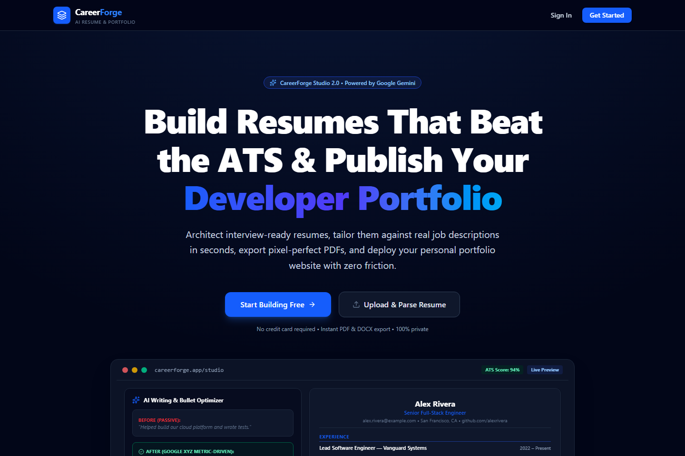
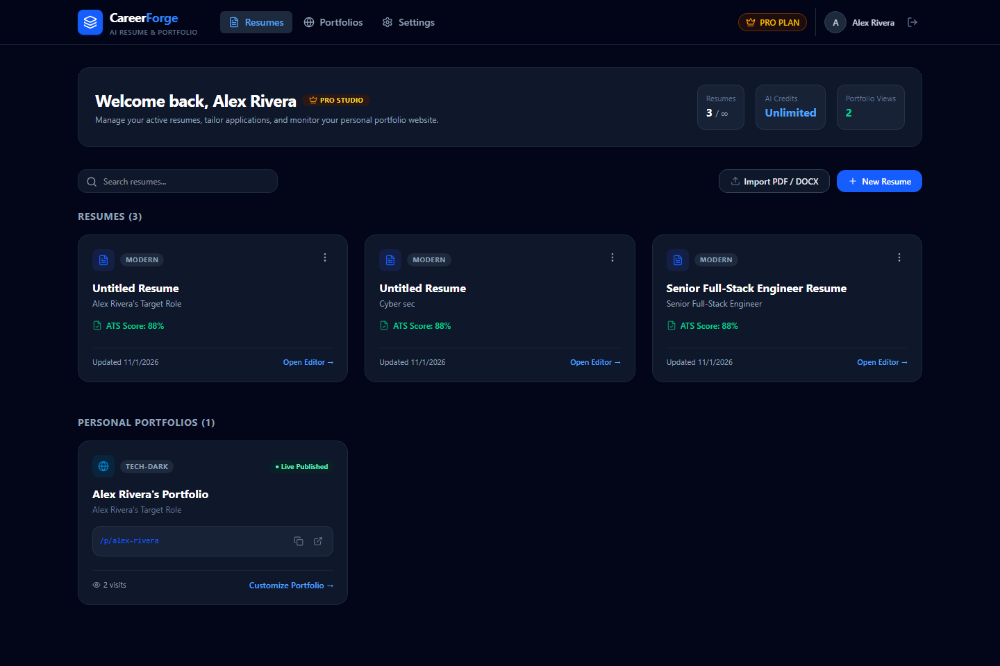
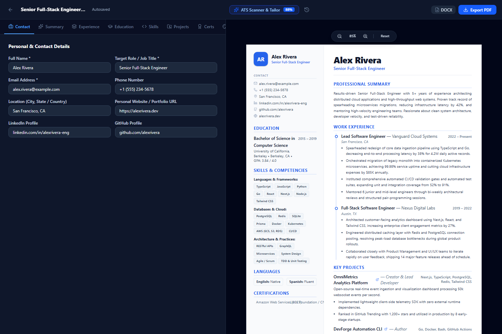
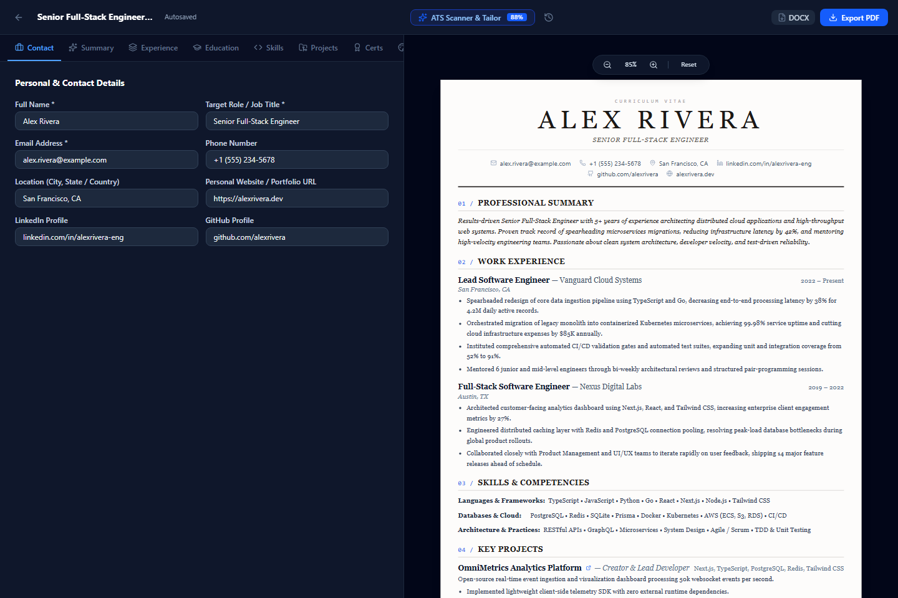
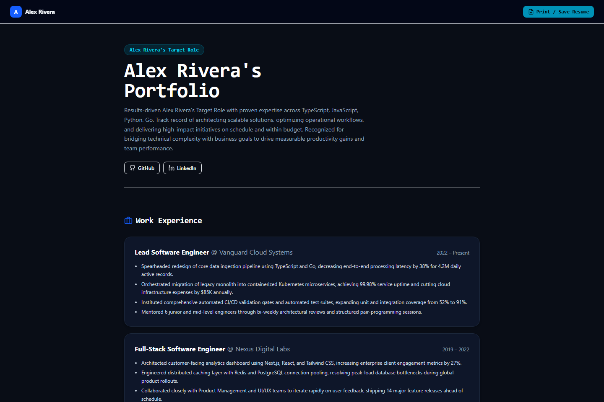
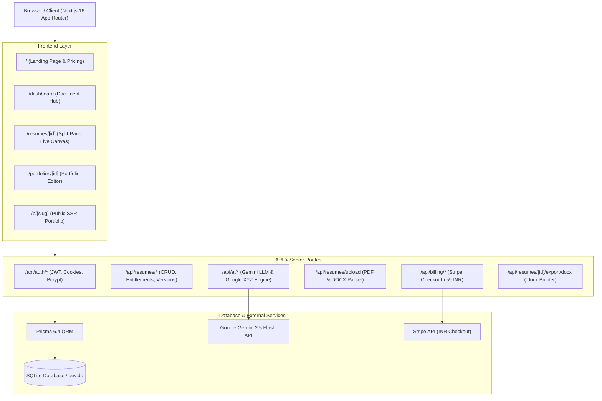

# CareerForge — AI-Powered Resume & Portfolio Studio 🚀

[](https://nextjs.org/)
[](https://www.typescriptlang.org/)
[](https://tailwindcss.com/)
[](https://www.prisma.io/)
[](https://aistudio.google.com/)
[](https://stripe.com/)
[](https://careerforge-studio.netlify.app)
[](LICENSE)

> 🌐 **Live Netlify Production URL**: [https://careerforge-studio.netlify.app](https://careerforge-studio.netlify.app)  
> 📑 **Viva & Technical Workflow Guide (PDF)**: [Download Viva PDF](https://careerforge-studio.netlify.app/CareerForge_Viva_and_Workflow_Guide.pdf) | [View Online HTML](https://careerforge-studio.netlify.app/viva-workflow-guide.html)  
> 💻 **GitHub Repository**: [https://github.com/ANNIEEONE/careerforge](https://github.com/ANNIEEONE/careerforge)

**CareerForge** is a production-ready, full-stack SaaS web application engineered to help software engineers, designers, product managers, and modern professionals architect ATS-proof resumes, tailor them against real job descriptions using Google Gemini AI, export vector PDFs and native Microsoft Word `.docx` files, and publish live personal developer portfolios with custom public URLs.

---

## 📸 Screenshots Showcase

### 1. Studio Landing Page & ₹59/mo Pro Tier


### 2. User Dashboard & Project Management


### 3. Split-Pane Live Editor with Pinterest "Swiss Sidebar" Layout
*Featuring 33% tinted sidebar with monogram badge, contact glyphs, skill badges, and a vertical timeline rail.*


### 4. Pinterest "Quiet Luxury Editorial" Layout
*Featuring Roman serif typography, wide tracking, and numbered sections (01/SUMMARY, 02/EXPERIENCE).*


### 5. Instant Personal Portfolio Generator
*Public responsive developer portfolio deployed at `/p/[slug]` with interactive contact form and live view counters.*


---

## 🌟 Key Product Features

### 1. AI Resume Studio & Live Split-Pane Canvas
- **Real-Time Split-Pane Editing**: Changes in personal info, experience, education, projects, skills, certifications, and languages reflect instantaneously on the live resume preview canvas.
- **8 Professionally Designed Templates**:
  - 🟢 **Modern Standard (Free)**: Balanced sans-serif layout with highest parser compatibility score.
  - 🟢 **Minimalist Slate (Free)**: High-contrast editorial typography with zero clutter.
  - 🔒 **Swiss Split Sidebar (Pro - Trending on Pinterest)**: Two-column layout with 33% tinted sidebar, circular monogram avatar, stacked contact glyphs, and a connected vertical timeline rail with node indicators.
  - 🔒 **Quiet Luxury Editorial (Pro - Most Pinned)**: Haute-couture serif typography (Playfair/Cormorant), wide tracking, and numbered index headers (`01 / SUMMARY`, `02 / EXPERIENCE`).
  - 🔒 **Nordic Clean (Pro - New)**: Bauhaus asymmetric clean layout with sharp accent bar and high-contrast chips.
  - 🔒 **Executive Serif (Pro)**: Classical serif hierarchy with subtle double rules for leadership roles.
  - 🔒 **Tech Matrix (Pro)**: Dense, high-information layout with monospace badges and developer tool grid.
  - 🔒 **Creative Studio (Pro)**: Expressive typography with banner headers and styled card badges.
- **Formatting Customization**: A4 and US Letter page sizes, typography scale, 6 accent colors (Indigo, Emerald, Rose, Slate, Violet, Amber), and layout adjustments.
- **Autosave & Document Version History**: Continuous autosave with version snapshots and one-click rollback.

### 2. Google Gemini AI Writing Engine & ATS Tailoring
- **Google Gemini 2.5 Flash Integration**: Real multimodal LLM endpoints with intelligent fallback heuristic algorithms.
- **Executive Summary Generator**: Synthesizes 3-4 sentence impactful value propositions tailored to target roles.
- **Bullet Improver (Google XYZ Formula)**: Converts weak passive statements into quantifiable accomplishment statements:
  > *"Accomplished [X], measured by [Y], by doing [Z]"*
- **Job-Description ATS Match Scanner**:
  - Compares candidate resume against pasted job description.
  - Calculates realistic ATS match score (0-100%).
  - Identifies matched keywords and highlights missing critical keywords.
  - Suggests targeted bullet improvements without keyword stuffing.
- **Targeted Cover Letter Generator**: Synthesizes customized cover letters tailored directly to the target role and company.

### 3. Multi-Format Document Export
- **Vector PDF Export**: Clean, printable PDF using native CSS `@media print` with crisp vector fonts, preserved page breaks, and zero raster degradation.
- **Native Microsoft Word `.docx` Generation**: Client-side/server-side `.docx` generation using the `docx` library with styled headings, bold role titles, bulleted accomplishments, and metadata.

### 4. Resume Upload & Document Parsing
- Supports drag-and-drop upload of **PDF**, **DOCX**, and **TXT** files.
- Extracts candidate name, email, phone, location, LinkedIn, GitHub, summary, work history, education, skills, and projects.
- Shows content completeness score and extraction analysis before loading into the studio.

### 5. Personal Web Portfolio Builder
- Converts resume data into an interactive personal website with a single click.
- 4 distinct portfolio themes:
  - `Minimalist Slate`
  - `Tech Obsidian` (Dark mode)
  - `Editorial Serif`
  - `Creative Warmth`
- Section toggles (About, Experience, Projects, Skills, Education, Interactive Contact Form).
- Public URL routing (e.g., `/p/alex-rivera`) with view counter and responsive mobile/desktop viewports.
- One-click public visibility switch (Publish / Unpublish).

### 6. Freemium Monetization & Server-Enforced Entitlements
- **Free Starter Plan**:
  - Up to 3 active resumes
  - Standard templates (`modern`, `minimal`)
  - 15 monthly AI writing credits
  - Unlimited PDF & Word exports
  - 1 public portfolio
- **Pro Plan (₹59 INR / month)**:
  - **Unlimited resumes** and document versions
  - **All 8 Premium Pinterest & ATS Templates** (Swiss Sidebar, Quiet Luxury, Nordic Clean, Executive, Tech Matrix, Creative)
  - **Unlimited AI writing and job tailoring**
  - **Unlimited ATS match scans & keyword optimizations**
  - **Unlimited portfolio websites** with custom slugs
- **Stripe Checkout Integration**: Configured with Indian Rupee (`currency: "inr"`, `unit_amount: 5900`).
- **Instant Test Mode Switcher**: In **Settings → Subscription**, click **"Switch to Pro (Test Mode)"** to immediately toggle between Free and Pro to test all premium templates and exports without requiring real payment cards.

---

## 🏗️ System Architecture



---

## 🛠️ Tech Stack

| Layer | Technology | Purpose |
|---|---|---|
| **Framework** | Next.js 16 (App Router + Turbopack) | Server-Side Rendering, API Routes, Streaming UI |
| **Language** | TypeScript 5 | End-to-end static type safety |
| **Styling** | Tailwind CSS v4 + Lucide Icons | Responsive styling, dark/light theme, modern UI |
| **Database & ORM** | Prisma 6.4 + SQLite | Schema migrations, typed queries, relations |
| **Authentication** | Jose (JWT) + BcryptJS | Secure HTTP-only cookies, password hashing |
| **AI LLM** | Google Gemini API + Rule Heuristics | Summary generation, XYZ bullets, ATS scoring |
| **Document Parser** | `pdf-parse` + `mammoth` | Extraction of resume fields from PDF and DOCX |
| **Document Export** | Print CSS (Vector PDF) + `docx` | High-fidelity multi-page PDF & Word downloads |
| **Payments** | Stripe API (`inr` / ₹59) | Checkout sessions, webhook verification |
| **Deployment** | GitHub + Netlify / Node.js | Continuous deployment & cloud hosting |

---

## 🚀 Quick Start & Local Setup

### Prerequisites
- **Node.js**: v20 or higher
- **npm** or **pnpm**

### Installation

```bash
# 1. Clone the repository
git clone https://github.com/ANNIEEONE/careerforge.git
cd careerforge

# 2. Install dependencies
npm install

# 3. Setup environment variables
cp .env.example .env

# 4. Initialize database schema
npx prisma db push

# 5. Build and launch application
npm run build
npm run start
```

Open **[http://localhost:3000](http://localhost:3000)** in your browser.

### Test Credentials
- **Email:** `demo@careerforge.io` (or `alex.rivera@example.com`)
- **Password:** `CareerForge123!`

---

## 🎓 Viva & Project Demonstration Highlights

If you are demonstrating this project for academic viva, practical review, or technical evaluation, check out the comprehensive **[Viva & Workflow Guide](docs/CareerForge_Viva_and_Workflow_Guide.pdf)** which includes:
- **System Design & Data Flow**: Deep dive into the client-server boundaries, Prisma models, and state persistence.
- **AI Integration Architecture**: How prompts are structured with Google's XYZ formula and how heuristic fallbacks protect against API rate limits.
- **ATS Scoring Algorithm**: Mathematical breakdown of keyword extraction, token frequency analysis, and relevance weighting.
- **Multi-Format Export Pipeline**: Vector Print CSS media queries vs Microsoft Word OpenXML (`docx`) document compilation.
- **Top 25 Viva Questions & Model Answers**: Complete coverage of common examiner questions (e.g., SSR vs CSR, SQL injection prevention, cookie security, and performance optimizations).

---

## 📄 License
This project is open-source and available under the [MIT License](LICENSE).
